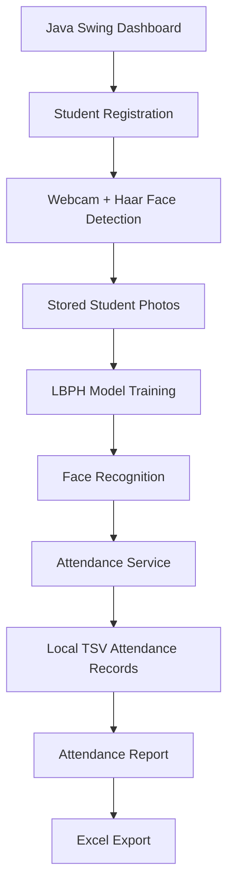

# Attendance Using Facial Recognition

A Java desktop application for consent-based student registration and facial-recognition attendance tracking.

This project uses a webcam, Haar Cascade face detection, and OpenCV LBPH recognition to identify students and record attendance locally. It is designed as an educational Stage project and should not be treated as a production-grade biometric access or identity-verification system.

## Why this project exists

The application helps a classroom or lab environment:

- register student information with consent,
- capture facial images from a webcam,
- train a local face-recognition model,
- recognize faces in real time,
- mark attendance once per student per day,
- export attendance records to Excel.

## Features

- Register a student with a unique ID and name after consent is confirmed.
- Preview live webcam input with face detection overlays.
- Capture multiple facial images and save them locally.
- Train a local LBPH face-recognition model from the saved student photos.
- Detect recognized faces and show `Unknown` for unmatched faces.
- Mark attendance after a face is recognized for five consecutive frames.
- Prevent duplicate attendance for the same student on the same local calendar day.
- View and refresh attendance records in a report screen.
- Export attendance report data to `.xlsx` with Apache POI.

## Architecture overview



## Technology stack

| Component | Technology |
|---|---|
| Language / runtime | Java 19 |
| Build tool | Maven |
| Desktop UI | Java Swing |
| Webcam and image processing | OpenPnP OpenCV Java 4.9.0-0 |
| Face recognition | OpenCV-contrib face module via JavaCPP/Bytedeco OpenCV 4.10.0 |
| Excel export | Apache POI 5.3.0 |
| Testing | JUnit 5, Maven Surefire |

OpenPnP OpenCV supplies the core image-processing and camera APIs, while the Windows x64 Maven profile adds the missing OpenCV-contrib face bindings and native libraries needed for LBPH training and prediction.

## Project structure

```text
AttendanceUsingFacialRecognition/
├── src/
│   ├── main/
│   │   ├── java/
│   │   │   └── com/attendance/...
│   │   └── resources/
│   └── test/
├── docs/
├── data/
├── pom.xml
├── README.md
└── PORTFOLIO.md
```

### Main packages

- `com.attendance.ui` — dashboard, registration, and attendance report screens
- `com.attendance.recognition` — webcam preview, face detection, model training, and recognition logic
- `com.attendance.service` — attendance persistence and export logic
- `src/main/resources` — Haar Cascade configuration files
- `src/test` — smoke tests for model training and recognition behavior

## Local data storage

The app saves runtime data under `data/`:

- `data/students/<student-id>/student.txt` and captured `.png` photos
- `data/models/lbph-model.yml` and `labels.tsv`
- `data/attendance/records.tsv`

These files are intentionally excluded from Git. A fresh checkout will require new student enrollment and model training.

## Requirements

Before running this project, make sure you have:

- 64-bit Windows
- JDK 19
- Apache Maven 3.9 or newer
- A working webcam
- Camera access enabled for desktop apps on Windows

## Setup and installation

1. Install a 64-bit JDK 19 and Apache Maven.
2. Set `JAVA_HOME` to your JDK folder.
3. Add both `JAVA_HOME\bin` and Maven's `bin` directory to your `PATH`.
4. Open the project folder containing `pom.xml` in VS Code or any Java-capable IDE.
5. Connect your webcam and allow camera access.

Check your environment:

```powershell
java -version
mvn -version
```

> The first project build downloads dependencies and native OpenCV libraries, so an internet connection is required the first time.

## Build, test, and run

From the folder containing `pom.xml`, run:

```powershell
mvn clean test
mvn clean compile
mvn exec:java
```

### What these commands do

- `mvn clean test` runs the project tests, including a native LBPH model smoke test.
- `mvn clean compile` compiles the application.
- `mvn exec:java` launches the Swing dashboard.

## How to use the app

1. Click **Register Student / Capture Photos**.
2. Enter a student ID and name.
3. Confirm the consent checkbox.
4. Center a face in the webcam view and capture multiple clear sample photos.
5. Repeat for each consenting student.
6. Click **Train Model** after enrollment.
7. Click **Recognize Faces** to preview detection without recording attendance.
8. Click **Mark Attendance** to record attendance after the system sees a face match for five consecutive frames.
9. Open **Attendance Reports / Export** to refresh records and export them as an `.xlsx` spreadsheet.

## Important notes about recognition

The Haar Cascade detects candidate face areas, and the LBPH model compares grayscale face images against the locally trained dataset. The recognition threshold is a practical starting point and may need adjustment based on your camera, lighting, and environment.

## Privacy and security

- Obtain informed consent before capturing or storing biometric images.
- Keep all student data, attendance data, and exported reports private.
- Do not commit or upload real photos, names, IDs, or attendance records to GitHub.
- Treat `data/` as sensitive storage; do not share it publicly.
- This project is not encrypted, access-controlled, or designed for multi-user production deployment.
- Facial recognition can produce false positives or false negatives.
- Always have a responsible person review attendance decisions.
- This is a learning/demo project and should not be the sole basis for important decisions.

## Troubleshooting

- **LBPH native library error**: confirm you are using a 64-bit JDK and 64-bit Windows, then rerun `mvn clean test`.
- **Webcam unavailable**: check Windows privacy settings and close other applications using the camera.
- **Model not working**: enroll students and capture multiple readable face photos before training the model.
- **GUI not responding**: open the app manually and verify preview, training, attendance marking, report refresh, and Excel export with test data.

## Screenshots

This project includes a placeholder for privacy-safe screenshots in `docs/screenshots/README.md`.

Use dummy data or consenting participants, and redact all names, IDs, and attendance records before sharing images.

## Screenshots checklist

- [ ] Dashboard with sample data
- [ ] Recognition screen with a non-identifiable participant
- [ ] Redacted Excel export screenshot

## License

This project is intended for educational use. Please check the repository for any additional licensing details before reuse or redistribution.
